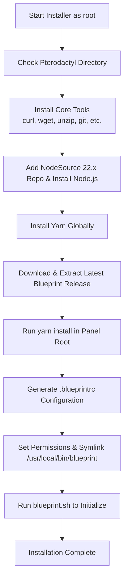

<div align="center">

# 📦 Blueprint Auto-Installer for Pterodactyl

Automated, production-ready installer for the **[Blueprint Framework](https://blueprint.zip)** on Pterodactyl Panel.

[](https://blueprint.zip/guides/admin/install)
[](LICENSE)
[](https://pterodactyl.io)
[](https://github.com/)

</div>

---

## ⚡ Quick Install (One-Liner)

Run the following command directly on your Pterodactyl server as `root` (replace `<USERNAME>` and `<REPO>` with your GitHub repository path once published):

```bash
bash <(curl -sSL https://raw.githubusercontent.com/<USERNAME>/<REPO>/main/install-blueprint.sh)
```

> [!NOTE]  
> If your script is hosted under your own GitHub account, replace `<USERNAME>/<REPO>` with your actual repository name.

---

## 🚀 Features

- **Official Compliance**: Implements all steps described in the [Blueprint Admin Installation Guide](https://blueprint.zip/guides/admin/install).
- **Automated Dependency Setup**: Sets up Node.js 22.x via official NodeSource keyrings and installs Yarn.
- **Auto-Detection**: Automatically detects your Pterodactyl root path and web server user (`www-data` or `nginx`).
- **Interactive Fallback**: Prompts for custom panel paths if not found in `/var/www/pterodactyl`.
- **Global Alias Linking**: Automatically symlinks `/usr/local/bin/blueprint` so you can manage extensions from any directory.
- **Permission Hardening**: Restores correct panel ownership and script execution permissions post-installation.

---

## 📋 Prerequisites

- **Operating System**: Ubuntu 20.04/22.04/24.04 or Debian 11/12.
- **Pterodactyl Panel**: A functioning installation of Pterodactyl Panel (`artisan` must exist).
- **Root / Sudo Privileges**: Script must be run as root (`sudo`).

---

## 🛠️ Manual Installation

If you prefer to clone or download the file manually:

```bash
# 1. Download installer script
wget -q https://raw.githubusercontent.com/<USERNAME>/<REPO>/main/install-blueprint.sh

# 2. Make executable
chmod +x install-blueprint.sh

# 3. Run with sudo
sudo ./install-blueprint.sh
```

### Custom Panel Directory

If your panel is installed in a non-standard directory (e.g., `/srv/pterodactyl`), define the `PTERODACTYL_DIRECTORY` variable beforehand:

```bash
sudo PTERODACTYL_DIRECTORY="/srv/pterodactyl" ./install-blueprint.sh
```

---

## 🧩 What the Installer Does



---

## 📖 Post-Installation Usage

Once the installation finishes, you can use Blueprint CLI anywhere on the server:

### View Help & Available Commands
```bash
blueprint --help
```

### Install an Extension
Upload any `.blueprint` extension file to your server and run:
```bash
blueprint -install /path/to/extension.blueprint
```

### Access Admin Panel
Open your browser and navigate to:
```
https://your-panel-domain/admin/extensions
```

---

## 🤝 Contributing

Contributions, bug reports, and pull requests are welcome!

1. Fork the Project
2. Create your Feature Branch (`git checkout -b feature/AmazingFeature`)
3. Commit your Changes (`git commit -m 'Add some AmazingFeature'`)
4. Push to the Branch (`git push origin feature/AmazingFeature`)
5. Open a Pull Request

---

## 📄 License

This project is open-source and distributed under the [MIT License](LICENSE).
